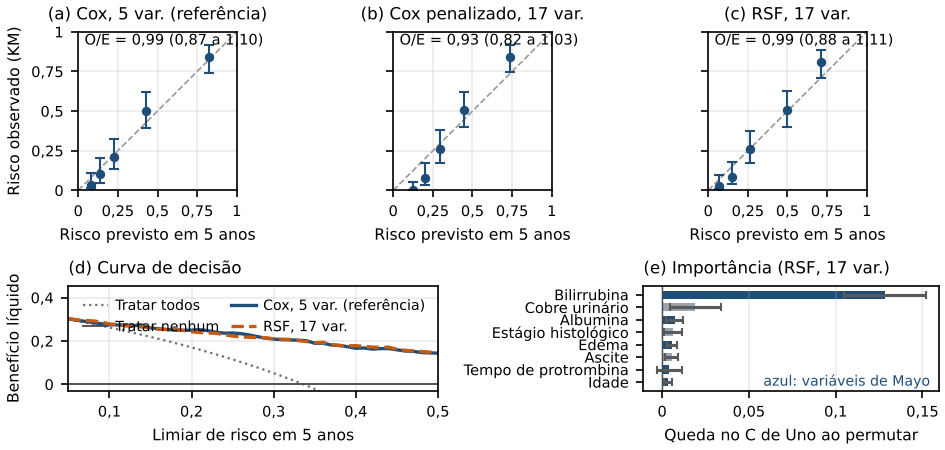

# O aprendizado de máquina supera o modelo clínico? Um estudo de caso em colangite biliar primária

**Trabalho final da disciplina** TCC00367, Introdução ao Aprendizado de Máquina para Saúde (PGC/UFF), em versão preparada para submissão ao SBCAS 2027.
**Autores:** Clayton Escouper das Chagas e Flávio Seixas (IC/UFF).

[](https://colab.research.google.com/github/claytonchagas/ml4health/blob/main/ml4health_cbp_mayo.ipynb)

| Material | Onde está |
|---|---|
| Notebook de demonstração | [`ml4health_cbp_mayo.ipynb`](ml4health_cbp_mayo.ipynb) (botão acima para abrir no Colab) |
| Artigo (template SBC, versão anonimizada para revisão) | [`sbcas/artigo/main.pdf`](sbcas/artigo/main.pdf) |
| Plano de análise registrado em 01/11/2026 | [`sbcas/PLANO_ANALISE.md`](sbcas/PLANO_ANALISE.md) |
| Desvios do plano e cronologia dos commits | [`sbcas/DESVIOS.md`](sbcas/DESVIOS.md), [`sbcas/CRONOLOGIA.md`](sbcas/CRONOLOGIA.md) |
| Material suplementar | [`sbcas/MATERIAL_SUPLEMENTAR.md`](sbcas/MATERIAL_SUPLEMENTAR.md) |
| Resultados (CSV) | [`resultados_sbcas/`](resultados_sbcas/) |

**Resultado em uma frase.** Nenhum modelo de aprendizado de máquina teve ganho demonstrado sobre o modelo de Cox com as cinco variáveis de Mayo (diferenças de C de Uno entre -0,014 e +0,015); um ganho de 0,02 ou mais só foi descartado para a random survival forest de 5 variáveis, e avaliar a floresta nos próprios pacientes de treino produziu um ganho aparente de 0,043, maior que qualquer diferença entre modelos.

> A primeira versão do trabalho (outubro de 2026: classificação de óbito em cinco anos com regressão logística, random forest e XGBoost) está preservada no ramo [`entrega-disciplina-out2026`](https://github.com/claytonchagas/ml4health/tree/entrega-disciplina-out2026). Ela virou uma das análises complementares desta versão (seção 4.4).

---

## 1. Motivação e objetivo

Um modelo de aprendizado de máquina (AM) para a saúde costuma ser apresentado pelo desempenho isolado. Quem decide adotá-lo faz outra pergunta: **o que ele acrescenta ao modelo clínico com que se compara?**

O caso é a colangite biliar primária (CBP, antes chamada de cirrose biliar primária), doença hepática autoimune e crônica que pode evoluir para cirrose e transplante. Desde 1989, o **modelo de Mayo** (Dickson et al., 1989) é a referência para estimar o risco que orienta o acompanhamento e o encaminhamento ao transplante: uma regressão de Cox com cinco variáveis de rotina (idade, bilirrubina, albumina, tempo de protrombina e edema). Os dados que o originaram são públicos e viraram um conjunto clássico de AM, inclusive numa competição do Kaggle; trabalhos recentes relatam vantagens do AM nesses dados, muitas vezes tratando o problema como classificação, excluindo pacientes censurados ou usando o tempo de seguimento como entrada, o que vaza o desfecho (Kapoor e Narayanan, 2023).

**Objetivo.** Num cenário hipotético de adoção, medir se um serviço que estima o risco com as cinco variáveis de Mayo ganharia algo ao trocar o Cox por uma floresta de sobrevivência, ou por um modelo com as 17 variáveis de linha de base, na predição de **óbito ou transplante em cinco anos**. A comparação é pareada (mesmos pacientes, mesmas partições), trata a censura como análise de sobrevivência e segue um **plano registrado antes da análise**. O trabalho separa três situações que se confundem quando se diz que o AM "supera" um modelo clínico: ganho não demonstrado, ganho relevante descartado e ganho aparente produzido pela forma de avaliar.

---

## 2. Descrição do dataset

### 2.1 Dados

- **Coorte:** 418 pacientes da Mayo Clinic com CBP, recrutados entre 1974 e 1984. Desses, 312 participaram de dois ensaios randomizados sobre D-penicilamina e 106 eram elegíveis mas recusaram a randomização, tendo só as medidas de rotina.
- **Variáveis de linha de base (17):** idade, sexo, tratamento atribuído, ascite, hepatomegalia, aranhas vasculares, edema, bilirrubina, colesterol, albumina, cobre urinário, fosfatase alcalina, AST, triglicerídeos, plaquetas, tempo de protrombina e estágio histológico. As **5 de Mayo** são idade, bilirrubina, albumina, tempo de protrombina e edema.
- **Desfecho e tempo:** situação ao fim do seguimento (censura, óbito ou transplante) e o tempo até ela, em dias (`N_Days`).
- **Desfecho principal:** sobrevida livre de transplante (evento = óbito ou transplante): 186 eventos, 132 deles até cinco anos; seguimento mediano de 7,0 anos (Kaplan-Meier reverso). **Sensibilidade:** só óbito, com o transplante tratado como censura (161 eventos, 115 até cinco anos).
- **Dados ausentes:** nove das variáveis extras só foram medidas nos ensaios e faltam em todos os 106 não randomizados; as cinco de Mayo faltam em apenas 2 pacientes.

### 2.2 Preparação e pré-processamento

1. **Codificação:** sexo, tratamento e achados de exame físico viram indicadores 0/1; edema segue a codificação de Mayo (0; 0,5; 1).
2. **Rótulo de sobrevivência:** cada paciente vira o par (tempo, evento). Nenhum paciente é excluído por ter saído do acompanhamento antes de cinco anos: a censura é tratada pelas métricas e pelos modelos de sobrevivência.
3. **`N_Days` nunca entra como preditor** nos modelos de sobrevivência: só se conhece depois do desfecho.
4. **Modelos de Cox:** logaritmo das variáveis laboratoriais assimétricas (com 5 variáveis, bilirrubina, albumina e protrombina, como no modelo original), imputação (mediana com 5 variáveis; imputação iterativa multivariada com 17) e padronização.
5. **Florestas:** só imputação, na escala original (árvores não dependem de transformações monotônicas).
6. Toda etapa que aprende com os dados (imputação, padronização, escolha de hiperparâmetros) fica **dentro de um `Pipeline`** e é refeita no treino de cada partição; o teste nunca influencia nenhuma decisão.

### 2.3 Link para a versão usada

- Dataset oficial: [UCI Machine Learning Repository, id 878, "Cirrhosis Patient Survival Prediction"](https://doi.org/10.24432/C5R02G) (licença CC BY 4.0).
- Cópia versionada usada na execução oficial: [`data/pbc_rdatasets.csv`](data/pbc_rdatasets.csv) (o `survival::pbc` do R, a mesma coorte e as mesmas variáveis do UCI 878), verificada por SHA-256 a cada carga (`experimento.py`).

---

## 3. Modelo de aprendizado de máquina

### 3.1 Formalização matemática

Cada paciente $i$ tem o vetor de variáveis de linha de base $\mathbf{x}_i$ ($p = 5$ ou $p = 17$), o tempo observado $T_i$ e o indicador de evento $\delta_i$ ($1$ = óbito ou transplante; $0$ = censura). Todos os modelos estimam a função de sobrevivência $S(t \mid \mathbf{x}) = P(T > t \mid \mathbf{x})$ e, dela, o **risco em cinco anos** $r(\mathbf{x}) = 1 - S(\tau \mid \mathbf{x})$, com $\tau = 1.826$ dias. É esse risco que se compara, calibra e usa na curva de decisão.

**Desenho 2 × 2.** Duas famílias, cada uma com as 5 variáveis de Mayo e com as 17:

| | 5 variáveis de Mayo | 17 variáveis |
|---|---|---|
| **Cox** | Cox de Mayo reestimado (**referência**) | Cox penalizado (*elastic net*) |
| **Aprendizado de máquina** | Random survival forest (RSF) | Random survival forest (RSF) |

**Cox de riscos proporcionais (referência).** O risco instantâneo é $h(t \mid \mathbf{x}) = h_0(t)\,\exp(\boldsymbol{\beta}^\top \tilde{\mathbf{x}})$, com $\tilde{\mathbf{x}}$ as variáveis transformadas e padronizadas. $\boldsymbol{\beta}$ maximiza a verossimilhança parcial (empates pelo método de Breslow)

$$\ell(\boldsymbol{\beta}) = \sum_{i:\,\delta_i = 1} \Big[\boldsymbol{\beta}^\top \tilde{\mathbf{x}}_i - \ln \sum_{j:\,T_j \ge T_i} \exp(\boldsymbol{\beta}^\top \tilde{\mathbf{x}}_j)\Big],$$

e $S(t \mid \mathbf{x}) = S_0(t)^{\exp(\boldsymbol{\beta}^\top \tilde{\mathbf{x}})}$, com $S_0$ estimada por Breslow. Com as cinco variáveis e as transformações de Mayo, reestimado no treino de cada partição, é o **Cox de Mayo reestimado**, a referência do plano.

**Cox penalizado (17 variáveis).** Mesma forma, com $\boldsymbol{\beta}$ obtido por

$$\min_{\boldsymbol{\beta}} \; -\frac{1}{n}\,\ell(\boldsymbol{\beta}) + \alpha\Big(\lambda \|\boldsymbol{\beta}\|_1 + \frac{1-\lambda}{2}\|\boldsymbol{\beta}\|_2^2\Big),$$

o *elastic net* (Simon et al., 2011), que encolhe ou zera coeficientes para evitar o sobreajuste; $\alpha$ (intensidade) e $\lambda$ (proporção L1) são hiperparâmetros.

**Random survival forest** (Ishwaran et al., 2008). Média de $B = 300$ árvores de sobrevivência, cada uma treinada numa amostra *bootstrap*; em cada nó, entre um subconjunto aleatório de variáveis, escolhe-se a divisão que maximiza a estatística *log-rank* entre os dois filhos. Cada folha estima a sobrevivência dos seus pacientes por Kaplan-Meier, e a floresta faz a média: $\hat S(t \mid \mathbf{x}) = \frac{1}{B}\sum_{b=1}^{B} \hat S_b(t \mid \mathbf{x})$.

**Fórmula de Mayo de 1989** (análise posterior ao plano). Os coeficientes publicados, sem reajuste: $R = 0{,}039\,\text{idade} + 0{,}871\ln(\text{bilirrubina}) - 2{,}53\ln(\text{albumina}) + 2{,}38\ln(\text{protrombina}) + 0{,}859\,\text{edema}$. Na discriminação, só a ordem de $R$ importa.

### 3.2 Método de validação

- **Validação cruzada 5 × 5:** 5 repetições de 5 partições estratificadas pelo evento (semente 2026), **as mesmas partições para os quatro modelos**, o que permite comparar em pares.
- **Ajuste de hiperparâmetros aninhado:** dentro do treino de cada partição externa, busca com 3 partições internas pelo C de Uno em cinco anos. Cox penalizado: grade completa de 40 combinações (proporção L1 em {0,1; 0,5; 0,9; 1} e 10 intensidades de $10^{-3}$ a 1). RSF: 50 configurações sorteadas (tamanho mínimo da folha, tamanho mínimo para dividir, variáveis por divisão e profundidade). O Cox de Mayo não tem hiperparâmetros.
- **Predições agregadas:** cada paciente recebe uma predição fora do treino em cada repetição; a média das cinco é a predição agregada, usada no valor incremental e na calibração.
- **Subgrupo fora do treino:** treino nos 312 randomizados e teste nos 106 não randomizados, que nenhum modelo viu (com 17 variáveis, é um teste de transporte, porque nove delas são imputadas nos 106).
- **Plano registrado:** desfechos, modelos, métricas, comparações e regra de leitura foram registrados em 01/11/2026 no controle de versões, antes da análise de sobrevivência ([`sbcas/PLANO_ANALISE.md`](sbcas/PLANO_ANALISE.md)); o que mudou depois está em [`sbcas/DESVIOS.md`](sbcas/DESVIOS.md), com data e motivo.

### 3.3 Medidas de desempenho

- **C de Uno em cinco anos** (principal; Uno et al., 2011). Entre pares de pacientes em que se sabe quem teve o evento primeiro (antes de $\tau$), é a fração em que o modelo deu risco maior a esse paciente, com cada par reponderado pela probabilidade de censura $\hat G$ (Kaplan-Meier da censura no treino):
$$C_\tau = \frac{\sum_{i,j} \delta_i\, \hat G(T_i)^{-2}\, \mathbf{1}(T_i < T_j,\, T_i < \tau)\, \mathbf{1}(r_i > r_j)}{\sum_{i,j} \delta_i\, \hat G(T_i)^{-2}\, \mathbf{1}(T_i < T_j,\, T_i < \tau)}.$$
  Vale 0,5 para o acaso e 1 para a ordenação perfeita.
- **AUC em cinco anos** (cumulativa/dinâmica; Uno et al., 2007).
- **Escore de Brier** em cinco anos e **integrado** de 1 a 5 anos (Graf et al., 1999): erro quadrático da probabilidade prevista, ponderado pela censura; menor é melhor.
- **Calibração:** risco previsto contra observado (Kaplan-Meier) por quintis, e a razão observado/esperado (O/E) na coorte; ideal 1.
- **Benefício líquido** (curva de decisão; Vickers et al., 2008), para a decisão hipotética de intensificar o acompanhamento de quem tem risco acima de um limiar $p_t$ entre 5% e 50%: $\text{BL}(p_t) = \frac{VP}{n} - \frac{FP}{n}\cdot\frac{p_t}{1-p_t}$, com verdadeiros e falsos positivos estimados por Kaplan-Meier. 0,01 equivale a um acerto líquido a mais por 100 pacientes.
- **Valor incremental:** $\Delta C = C(\text{modelo}) - C(\text{referência})$ nos mesmos 418 pacientes, sobre as predições agregadas. Incerteza por 2.000 reamostragens *bootstrap* pareadas de pacientes, com intervalo de **Bonferroni** para três comparações (98,3%). Depois dos resultados, acrescentou-se o **teste t corrigido** para validação cruzada repetida (Nadeau e Bengio, 2003), que amplia o erro-padrão das 25 diferenças por partição pelo fator $\sqrt{1/25 + n_{\text{teste}}/n_{\text{treino}}}$, porque as partições compartilham pacientes de treino.
- **Regra de leitura (margem de +0,02 no C de Uno, fixada no plano):** se o intervalo exclui zero, a diferença está **demonstrada**; se o limite superior fica abaixo de +0,02, um ganho dessa ordem está **descartado** (desde a regra combinada, só quando os dois métodos o descartam); se o intervalo inclui zero e passa da margem, a coorte **não decide**. A margem é um critério de leitura, não um limiar clínico validado.

---

## 4. Avaliação

### 4.1 Amostras usadas para treinamento, validação e teste

| Análise | Treinamento | Validação (escolha de hiperparâmetros) | Teste |
|---|---|---|---|
| Validação cruzada 5 × 5 (principal) | 334 a 335 pacientes por partição | 3 partições internas dentro do treino (cerca de 2/3 para ajustar e 1/3 para avaliar cada configuração) | 83 a 84 pacientes por partição; 25 avaliações; cada paciente é testado uma vez por repetição |
| Subgrupo fora do treino | 312 randomizados | 3 partições internas nos 312 | 106 não randomizados (42 eventos) |
| Ganho aparente de avaliar no treino | 312 randomizados (mesmas partições 5 × 5) | idem | os próprios pacientes de treino contra fora da partição |
| Classificação em cinco anos (versão de outubro) | 5 × 5 estratificada | 3 partições internas | 312 pacientes rotulados (115 óbitos), sem os censurados antes de cinco anos |
| Vazamento por `N_Days` (tarefa do Kaggle, 3 classes) | 5 × 5 estratificada | sem busca | 418 pacientes |

### 4.2 Medidas de desempenho

**Desempenho no desfecho principal** (média e desvio nas 25 partições; O/E nas predições agregadas):

| Modelo | C de Uno | AUC 5 anos | Brier 5 anos | Brier integrado | O/E 5 anos (IC 95%) |
|---|---|---|---|---|---|
| Cox, 5 var. (referência) | 0,833 (0,029) | 0,889 (0,031) | 0,128 (0,021) | 0,102 (0,009) | 0,99 (0,87 a 1,10) |
| Cox penalizado, 17 var. | 0,846 (0,024) | 0,903 (0,028) | 0,132 (0,018) | 0,104 (0,008) | 0,93 (0,82 a 1,03) |
| RSF, 5 var. | 0,821 (0,034) | 0,869 (0,039) | 0,143 (0,019) | 0,107 (0,009) | 0,99 (0,87 a 1,10) |
| RSF, 17 var. | 0,832 (0,028) | 0,886 (0,031) | 0,135 (0,015) | 0,104 (0,008) | 0,99 (0,88 a 1,11) |

**Valor incremental** ($\Delta C$ no C de Uno em cinco anos, predições agregadas; referência agregada 0,831, e 0,850 só com óbito):

| Comparação contra o Cox de Mayo reestimado | ΔC | IC 98,3%, bootstrap (plano) | IC 98,3%, teste t corrigido | Ganho de 0,02 descartado? |
|---|---|---|---|---|
| **Óbito ou transplante (desfecho principal)** | | | | |
| Cox penalizado, 17 var. | 0,015 | −0,0042 a 0,0324 | −0,012 a 0,038 | não |
| RSF, 5 var. | −0,014 | −0,0323 a 0,0042 | −0,036 a 0,011 | sim |
| RSF, 17 var. | −0,001 | −0,0220 a 0,0197 | −0,027 a 0,024 | não (só no plano) |
| **Só óbito (sensibilidade)** | | | | |
| Cox penalizado, 17 var. | 0,010 | −0,0064 a 0,0261 | −0,009 a 0,030 | não |
| RSF, 5 var. | −0,013 | −0,0313 a 0,0030 | −0,050 a 0,006 | sim |
| RSF, 17 var. | −0,007 | −0,0292 a 0,0144 | −0,042 a 0,025 | não (só no plano) |

Leitura: **nenhum modelo teve ganho demonstrado** (nenhum intervalo exclui zero, nos dois métodos). Um ganho de 0,02 só foi descartado para a **RSF de 5 variáveis**. Para o **Cox penalizado**, o modelo de maior C, a coorte não decide. Para a **RSF de 17 variáveis**, o limite do plano (0,0197) ficou logo abaixo da margem, o do teste corrigido a ultrapassou, e trocar a semente do *bootstrap* mudou o lado em 10 de 25 sementes (de 0,0188 a 0,0212): caso inconclusivo. A meia-largura dos intervalos (0,018 a 0,021 no *bootstrap*) é da ordem da própria margem: com 132 eventos até cinco anos, só um modelo com estimativa negativa pode ter um ganho de 0,02 descartado.

**Calibração e utilidade clínica.** A razão O/E ficou entre 0,93 e 0,99. Nos quintis, os desvios da referência ficaram dentro dos intervalos; o desvio mais nítido foi o do Cox penalizado, que superestimou o risco nos dois quintis mais baixos e o subestimou no mais alto. Na curva de decisão, referência e RSF de 17 variáveis quase se sobrepõem entre 5% e 50%; a maior distância (1,5 acerto líquido por 100 pacientes, no limiar de 26%) favoreceu a referência.



*(a) a (c): calibração em cinco anos por quintis de risco previsto; (d) curva de decisão; (e) importância por permutação na RSF de 17 variáveis (a bilirrubina domina, com queda de 0,128 no C de Uno).*

**Subgrupo fora do treino** (treino nos 312, teste nos 106 não randomizados, com 42 eventos):

| Modelo | C de Uno (IC 95%) | AUC 5 anos (IC 95%) | O/E 5 anos |
|---|---|---|---|
| Cox, 5 var. (referência) | 0,790 (0,718 a 0,857) | 0,844 (0,744 a 0,922) | 1,05 |
| Cox penalizado, 17 var. | 0,806 (0,736 a 0,869) | 0,869 (0,783 a 0,938) | 1,06 |
| RSF, 5 var. | 0,797 (0,726 a 0,861) | 0,857 (0,762 a 0,931) | 1,12 |
| RSF, 17 var. | 0,807 (0,738 a 0,871) | 0,870 (0,782 a 0,940) | 1,16 |

Os três modelos alternativos ficaram nominalmente à frente, sem nenhuma diferença demonstrada.

**Contra a fórmula de 1989** (análise posterior ao plano, avaliada nos pacientes em que foi estimada, C de Uno 0,831): o Cox reestimado ficou praticamente igual a ela (0,001), e nenhum modelo de AM teve ganho demonstrado.

### 4.3 De onde vêm os ganhos aparentes

| Escolha de avaliação | Comparação | Efeito |
|---|---|---|
| Avaliar no próprio treino | RSF de 17 variáveis, no treino contra fora da partição (312) | C de Uno +0,043 |
| Avaliar no próprio treino | Cox de Mayo, idem (312) | C de Uno +0,007 |
| Vazamento do desfecho | XGBoost de 17 variáveis com e sem `N_Days` (418, três classes) | AUROC macro +0,034 |

O maior ganho aparente, avaliar a floresta nos próprios pacientes de treino, é maior que todas as diferenças entre modelos (comparação de ordem de grandeza: as amostras diferem e o otimismo não tem intervalo).

### 4.4 Classificação em cinco anos (versão de outubro)

Na tarefa binária de óbito em cinco anos, com exclusão dos censurados antes do prazo (312 pacientes, 115 óbitos), nenhuma alternativa superou a regressão logística com 5 variáveis (melhor diferença de AUROC: +0,009, de -0,017 a 0,035, com Bonferroni para 5 comparações). O código dessa análise é `experimento.py`; os resultados estão em [`resultados/`](resultados/).

---

## 5. Conclusão

A resposta à pergunta do título é **"não demonstrado"**, e não "não supera". Na coorte pública da Mayo Clinic, sob plano registrado e num cenário de adoção que favorece a referência, nem a RSF nem o Cox penalizado mostraram ganho sobre o Cox reestimado com as cinco variáveis de Mayo na predição de óbito ou transplante em cinco anos. Um ganho de 0,02 ou mais no C de Uno só foi descartado para a RSF de 5 variáveis; para os outros dois, a coorte é pequena demais para decidir. Em análises posteriores, nenhum superou a fórmula de 1989, e avaliar a floresta no próprio treino produziu um ganho aparente maior que as diferenças entre modelos.

A lição é de método: julgar o ganho do AM contra o modelo clínico pertinente, fora da amostra de treino, com a incerteza explícita e sem variáveis que vazem o desfecho.

**Limitações.** Dados de um só centro, de 1974 a 1984, antes do ácido ursodesoxicólico; sem coorte externa (os 106 são do mesmo centro e época); a ponderação pela censura supõe censura independente dos preditores; na sensibilidade só com óbito, censurar o transplante não substitui uma análise de riscos competitivos; fórmula de 1989, fontes de ganho aparente e regra combinada são análises posteriores aos resultados; a conclusão vale para os modelos e grades avaliados (não testamos boosting nem redes neurais na sobrevivência). O passo seguinte é repetir a comparação em coortes atuais de pacientes tratados, contra os escores GLOBE e UK-PBC e com riscos competitivos.

---

## 6. Plano, desvios e auditoria

O plano foi registrado antes da análise de sobrevivência; há dezessete desvios, todos com data, motivo e commit em [`sbcas/DESVIOS.md`](sbcas/DESVIOS.md) e [`sbcas/CRONOLOGIA.md`](sbcas/CRONOLOGIA.md). O principal veio de uma auditoria do código feita por outro agente de IA (Codex, sem permissão para alterar o repositório; relatórios em [`auditoria/`](auditoria/) e [`AUDITORIA.md`](AUDITORIA.md)): na primeira execução, as florestas eram ajustadas com uma saída de risco diferente da avaliada; o procedimento foi corrigido e a análise repetida.

---

## Como executar

**No Colab (recomendado para a apresentação).** Clique no botão "Abrir no Colab" e execute as células em ordem. O notebook clona este repositório, instala o que faltar e tem três modos, escolhidos na seção 2.4:

| Modo | O que faz | Tempo aproximado |
|---|---|---|
| `"apresentacao"` (padrão) | Carrega os dados, mostra as curvas de iteração e uma partição treinada ao vivo, e lê os resultados oficiais de `resultados_sbcas/` para as tabelas e gráficos | 2 a 4 minutos |
| `"rapido"` | Refaz a validação cruzada com 1 repetição (5 partições) e um *bootstrap* menor, sem gravar por cima dos resultados oficiais | 15 a 25 minutos |
| `"completo"` | Executa `sobrevivencia.py` e os scripts complementares, regravando `resultados_sbcas/` | várias horas no Colab gratuito (a execução oficial do desfecho principal levou cerca de 76 minutos) |

A seção 5 do notebook é uma **demonstração interativa opcional** (Gradio): o mesmo paciente no Cox de Mayo e na random survival forest de 5 variáveis, com o risco em cinco anos e as curvas de sobrevivência. É didática, não é ferramenta clínica, e não altera as seções anteriores.

**Localmente** (Python 3.11 ou mais novo; a execução oficial usou Python 3.13.18, scikit-learn 1.9.1 e scikit-survival 0.28.0):

```bash
uv venv --python 3.13 .venv && source .venv/bin/activate
uv pip install -r requirements.txt
python sobrevivencia.py                      # desfecho principal (validação cruzada, valor incremental, subgrupo)
python sobrevivencia.py --desfecho obito     # sensibilidade
python ic_desempenho.py && python calibracao_figura.py && python curva_decisao.py
python importancia_permutacao.py && python comparador_graf.py && python mayo1989.py
python sbcas/artigo/gerar_tabelas.py && python gerar_readme.py && bash sbcas/artigo/compilar.sh
```

Para os números deste README e do artigo, use as versões do `requirements.txt`. No Colab, o notebook usa as versões disponíveis lá, e uma reexecução pode diferir na terceira casa decimal.

## Estrutura do repositório

| Caminho | Conteúdo |
|---|---|
| `sobrevivencia.py` | Análise principal: modelos, validação cruzada aninhada, métricas, valor incremental e subgrupo |
| `ic_desempenho.py`, `calibracao_figura.py`, `curva_decisao.py`, `importancia_permutacao.py`, `pressupostos_cox.py` | Teste t corrigido, calibração, curva de decisão, importância e riscos proporcionais |
| `comparador_graf.py`, `mayo1989.py`, `sensibilidade_semente.py` | Análises posteriores ao plano (ganho aparente, fórmula de 1989, sementes do *bootstrap*) |
| `experimento.py`, `tabela_enquadramentos.py` | Carga dos dados e classificação em cinco anos (versão de outubro, inclusive o vazamento por `N_Days`) |
| `construir_notebook.py`, `gerar_readme.py` | Geram o notebook e este README a partir do código e dos resultados |
| `sbcas/` | Plano, desvios, cronologia, suplementar e o artigo em LaTeX (template SBC) |
| `artigo/` | Artigo da primeira versão (outubro de 2026, template da disciplina) |
| `resultados_sbcas/`, `resultados/` | Resultados em CSV e figuras |

## Referências

- Christodoulou, E. et al. A systematic review shows no performance benefit of machine learning over logistic regression for clinical prediction models. *Journal of Clinical Epidemiology*, 110:12-22, 2019.
- Dickson, E. R. et al. Prognosis in primary biliary cirrhosis: model for decision making. *Hepatology*, 10(1):1-7, 1989.
- Graf, E. et al. Assessment and comparison of prognostic classification schemes for survival data. *Statistics in Medicine*, 18(17-18):2529-2545, 1999.
- Ishwaran, H. et al. Random survival forests. *The Annals of Applied Statistics*, 2(3):841-860, 2008.
- Kapoor, S.; Narayanan, A. Leakage and the reproducibility crisis in machine-learning-based science. *Patterns*, 4(9):100804, 2023.
- Nadeau, C.; Bengio, Y. Inference for the generalization error. *Machine Learning*, 52(3):239-281, 2003.
- Pölsterl, S. scikit-survival: a library for time-to-event analysis built on top of scikit-learn. *Journal of Machine Learning Research*, 21(212):1-6, 2020.
- Simon, N. et al. Regularization paths for Cox's proportional hazards model via coordinate descent. *Journal of Statistical Software*, 39(5):1-13, 2011.
- Uno, H. et al. On the C-statistics for evaluating overall adequacy of risk prediction procedures with censored survival data. *Statistics in Medicine*, 30(10):1105-1117, 2011.
- Uno, H. et al. Evaluating prediction rules for t-year survivors with censored regression models. *Journal of the American Statistical Association*, 102(478):527-537, 2007.
- Vickers, A. J. et al. Extensions to decision curve analysis. *BMC Medical Informatics and Decision Making*, 8:53, 2008.

A lista completa está no artigo ([`sbcas/artigo/main.pdf`](sbcas/artigo/main.pdf)).
